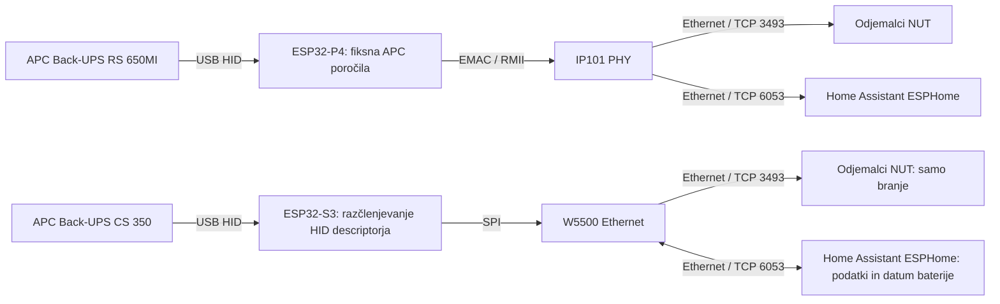

# Primerjava ESP32-P4 in ESP32-S3 z APC UPS

Stanje: 2026-11-25. Primerjava velja za spodnji preverjeni kombinaciji.
Oznaka »ESP32-S3 POE ETH UPS« je ime obstoječe naprave; točen proizvajalec in
revizija njene plošče nista bila neodvisno potrjena. Preverjen je spodnji W5500
pinout. Oznaka PoE sama ne opisuje komunikacije z UPS.

## Strojna oprema in konfiguracija

| Lastnost | P4 + Back-UPS RS 650MI | S3 + Back-UPS CS 350 |
|---|---|---|
| MCU / ESPHome board | ESP32-P4 / `esp32-p4-evboard` | ESP32-S3 / `esp32-s3-devkitc-1` |
| UPS firmware | `939.g4` | `807.q10 .I USB FW:q10` |
| Flash v konfiguraciji gradnje | 16 MB | 4 MB, privzeta nastavitev board; fizična velikost ni posebej izmerjena |
| Ethernet | Izvorni EMAC, IP101 PHY prek RMII | W5500 prek SPI |
| Ethernet pini | MDC 31, MDIO 52, power 51, zunanji clock input 50; PHY naslov 1 | MOSI 11, MISO 12, SCLK 13, CS 14, INT 10, RESET 9 |
| Povezava z UPS | USB HID, gostitelj je ESP | USB HID, gostitelj je ESP |
| USB sklad | Lokalni `ups_hid` / ESP-IDF USB Host | Lokalni `ups_hid` / ESP-IDF USB Host; brez dodatnega `usb_host:` |
| Lokalna mapa komponent | `components/ups_nut_esp32p4` | `components/ups_nut_esp32s3` |
| Preverjeni ESPHome | 2026.10.2 | 2026.11.1 |
| ESP-IDF / GCC | 5.5.6 / 14.2.0 | 5.5.6 / 14.2.0 |

GPIO številke veljajo za ti konfiguraciji, ne za poljubno P4 ali S3 ploščo.
Menjava MCU zahteva pregled board nastavitev, USB povezave, napajanja in
Ethernet pinov. Menjava modela UPS zahteva preverjanje njegovih HID poročil.

## Poti komunikacije

Strežnik NUT teče na ESP; W5500 in IP101 sta dela Ethernet poti. UPS nima
strežnika NUT. HA lahko bere podatke prek integracije NUT ali ESPHome. Vpis
datuma baterije pri S3 uporablja pot ESPHome → USB HID `SET_REPORT` → UPS;
NUT te možnosti ne izpostavlja. OTA posodobitev ESP uporablja TCP 3232.

## Zakaj prenos prvotne kode ni zadostoval

P4 je bil preverjen z drugim modelom APC. Številka HID poročila ni univerzalen
pomen spremenljivke: ista predpostavka o ID, položaju ali merilu lahko na drugem
UPS vrne napačno napetost, stanje ali metapodatke. To je razlika **med UPS**, ne
lastnost procesorja S3 ali P4. Oba uporabljata isti razred USB HID.

| Področje | Prvotna rešitev P4 | Rešitev v različici S3 |
|---|---|---|
| Prepoznavanje nizov | Za RS 650MI preverjeni indeksi manufacturer/product/serial `1/2/3` | Indeksi iz USB device descriptorja; CS 350 uporablja `3/1/2` |
| APC podatki | Fiksni ID in razporedi poročil za preverjeno enoto | HID usage page, collection, report type/ID, bitni odmiki, predznak, logične/fizične meje in eksponent |
| Neznan razpored | Fiksni razpored ni dokaz za drug model | Brez ugibanja APC odmikov, če descriptor ni veljaven |
| Omrežno stanje UPS | Sklepanje iz veljavne vhodne napetosti | HID zastavice ACPresent, Discharging in low battery |
| Vhodna napetost CS 350 | Prenos predpostavk ni zanesljiv | Če meritve ni, ostane nedosegljiva; nazivna napetost ni predstavljena kot meritev |
| USB življenjska doba prenosa | Starejša izvedba | Skupni kontekst callbackov za GET/SET/descriptor; timeout ne pušča kazalca na že sproščen kontekst |
| Periodično branje APC | Fiksno branje poročil | Descriptor določa potrebna poročila; stara fiksna pot je izključena za ta način |
| TCP NUT | Prvotna izvedba | Medpomnilnik vrstic pravilno sestavi razdeljene ukaze in več ukazov v enem paketu; podprt standardni `LOGIN <ups>` |
| Nastavitve NUT | Ime/prijava iz YAML | Preverjeno ime in stikalo prijave med delovanjem, shranjena prek ponovnega zagona |
| Vzdrževanje | Brez vpisa datuma v konfiguraciji | Branje datumov in rezultata testa, nadzorovan vpis datuma samo prek ESPHome |

P4 že vsebuje svoje popravke: eksplicitne reference tovarn protokolov zaradi
linkerja, združljivost z ESPHome/ESP-IDF, pravilno uporabo `::socket`, inicializacijo
USB struktur in popravek APC poročila `0x09` v baterijsko napetost. Napačnega
izhoda 135 V zato ne objavlja kot izhodno napetost. Ti popravki so opisani v
[zgodovinskem zapisu P4](changes.md).

## Uporabniške možnosti

| Možnost | P4 konfiguracija | S3 konfiguracija |
|---|---|---|
| Ime NUT | YAML | `NUT UPS name`, privzeto `racktest`; trajno, 1–32 ASCII znakov `A–Z a–z 0–9 _ . -` |
| Avtentikacija | Nastavljene poverilnice | `NUT authentication`, privzeto izključena; po vklopu uporabi pripravljene poverilnice |
| Politika NUT | Preizkušeni samo bralni ukazi; brez splošnega `read_only` | `read_only: true`; `SET VAR`, `INSTCMD` in `FSD` zavrnjeni tudi po prijavi |
| Datum menjave baterije | Brez konfiguriranega writerja | NUT `battery.date` samo berljivo; ESPHome nastavitev/akcija za zapis |
| Datum izdelave baterije | Ni del te razširitve | NUT `battery.mfr.date`, samo branje |
| Zadnji samotest | Ni del te razširitve | NUT `ups.test.result`, rezultat; časovni žig ni na voljo |

Preimenovanje NUT ni sprememba identitete UPS v Home Assistantu. Integracija NUT
identiteto izpelje iz proizvajalca, modela in serijske številke. Isti fizični UPS
je zato lahko »že konfiguriran« tudi ob drugem IP ali imenu. Preglej obstoječi,
morda onemogočeni vnos in ga ponovno konfiguriraj.

## Kje so spremembe S3

| Datoteke v `components/ups_nut_esp32s3` | Namen |
|---|---|
| `ups_hid/hid_descriptor.h`, `descriptor_transport.cpp`, `protocol_apc_descriptor.cpp` | Razčlenjevanje descriptorja in APC meritve po usage |
| `ups_hid/transport_esp32.*`, `transport_interface.h` | USB descriptorji, varen GET/SET prenos in callbacki |
| `ups_hid/maintenance_values.h`, `protocol_apc.*`, `data_battery.h`, `data_power.h` | Datumi, testni rezultat in zapis datuma z odčitkom |
| `ups_hid/battery_date_text.h`, `text.py`, `text_sensor.py`, `ups_hid.*` | ESPHome entitete in API za vzdrževanje |
| `nut_server/nut_server.*`, `__init__.py` | Bralna politika, prijava, TCP vrstice in objava spremenljivk |
| `nut_server/name_text.h`, `text.py` | Preverjanje in trajna hramba imena; neveljavno ime ne prepiše prejšnjega |

Celotna kopija komponent omogoča reprodukcijo rešitve brez spremembe komponent
P4 ali drugih naprav. Ime mape S3 ne pomeni, da je parser vezan izključno na S3;
prenos na P4 ali drug UPS zahteva nove preizkuse.

## Dokazi in meje

Podrobnosti: [preizkusi P4](testing.md) in [preizkusi S3](testing-s3.md).
Na obeh je bila potrjena komunikacija z navedenim UPS. Na S3 so bili preverjeni
tudi prijava/brez prijave, obstojnost nastavitev, varovanje NUT in zapis
**istega obstoječega datuma** z USB potrditvijo in ponovnim odčitkom.
Sprememba na drug datum in ohranitev datuma po fizičnem izklopu UPS nista
preverjeni. Samotest, izklop bremena in fizični prehod omrežje → baterija niso
bili sproženi. Generic/CyberPower izvorna koda ni dokaz preverjene podpore.

Referenčni viri: [NUT podatki za APC CS 350](https://networkupstools.org/ddl/APC/Back-UPS_CS_350.html),
[APC HID preslikave NUT](https://github.com/networkupstools/nut/blob/master/drivers/apc-hid.c),
[HA integracija NUT](https://www.home-assistant.io/integrations/nut/).
